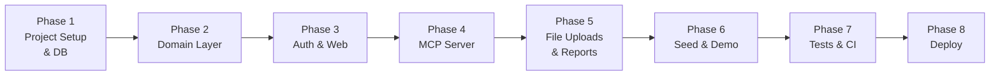

# Spendwise — Implementation Plan

> **Goal:** Ship a working v1 at a public URL where a reviewer can connect Claude, drop 3 receipt photos, and see a correctly flagged draft claim — with manager approval, audit log, reports, and CSV export all working.

---

## Overview



---

## Phase 1 — Project Setup & Database

### 1.1 Repo & Tooling

- [ ] Init repo: `git init`, add `.gitignore` (node_modules, .env, dist)
- [ ] `package.json` with scripts: `dev`, `build`, `start`, `migrate`, `seed`, `test`
- [ ] TypeScript config (`tsconfig.json`): `target: ES2022`, `module: NodeNext`, strict mode
- [ ] ESLint + Prettier
- [ ] Vitest config
- [ ] `Dockerfile` (Node 22 slim, copy built files, `npm run start`)
- [ ] `.env.example`:
  ```
  DATABASE_URL=
  SESSION_SECRET=
  APP_URL=
  S3_ENDPOINT=
  S3_BUCKET=
  S3_ACCESS_KEY=
  S3_SECRET_KEY=
  S3_REGION=
  ```
- [ ] CI check script that greps for banned AI packages and env vars matching `/(OPENAI|ANTHROPIC|GEMINI|MISTRAL|COHERE)_/`

### 1.2 Database Schema & Migrations

> Money is stored as **integer paise** (`amount_minor`). Never floats.

Use **Drizzle ORM** with Postgres in production, SQLite for local dev.

- [ ] Install: `drizzle-orm`, `drizzle-kit`, `postgres` (or `better-sqlite3` for dev)
- [ ] `src/db/schema.ts` — define all tables:

| Table | Key Fields |
|---|---|
| `organisations` | id, name, base_currency, created_at |
| `users` | id, org_id, email, name, password_hash, role, manager_id, created_at |
| `mcp_tokens` | id, user_id, token_hash, label, last_used_at, created_at, revoked_at |
| `policy` | org_id, receipt_required_above_minor, gstin_required_above_minor, allow_weekend_spend, notes |
| `categories` | id, org_id, name, code, per_item_limit_minor, per_day_limit_minor, active |
| `claims` | id, org_id, user_id, title, purpose, trip_start, trip_end, status, submitted_at, decided_at, decided_by, paid_at, source, created_at, updated_at |
| `expenses` | id, claim_id, date, merchant, category_id, description, amount_minor, currency, fx_rate, gstin, taxable_minor, cgst_minor, sgst_minor, igst_minor, payment_method, receipt_url, status, reviewer_note, flags (json), created_at, updated_at |
| `comments` | id, claim_id, user_id, body, created_at |
| `audit_log` | id, org_id, actor_user_id, actor_via, entity, entity_id, action, before (json), after (json), created_at |

- [ ] `src/db/migrations/` — generate and check in initial migration
- [ ] `src/db/index.ts` — DB connection singleton

---

## Phase 2 — Domain Layer

> Business logic lives **only** in `src/domain/`. Both the web routes and MCP tools call these same functions — Claude and humans always get identical behaviour and permissions.

### 2.1 `src/domain/money.ts`
- [ ] `toPaise(major: number): number` — multiply by 100, round
- [ ] `toMajor(minor: number): number` — divide by 100
- [ ] `formatINR(minor: number): string` — e.g. `₹1,23,456.00`

### 2.2 `src/domain/gstin.ts`
- [ ] `validateGSTIN(gstin: string): boolean` — format regex + checksum validation
- [ ] Export the validation function (used in rule checks)

### 2.3 `src/domain/rules.ts`

Deterministic rule checks run on every create/update. Returns an array of flag codes.

| Flag Code | Rule |
|---|---|
| `OVER_ITEM_LIMIT` | `amount_minor > category.per_item_limit_minor` |
| `OVER_DAY_LIMIT` | sum of category on that date > per_day_limit_minor |
| `MISSING_RECEIPT` | amount > receipt threshold AND no `receipt_url` (checked on submit only) |
| `MISSING_GSTIN` | amount > GSTIN threshold AND GSTIN empty |
| `GST_MISMATCH` | `taxable + cgst + sgst + igst ≠ amount` (±₹1 tolerance = ±100 paise) |
| `WEEKEND` | date is Sat/Sun AND `policy.allow_weekend_spend = false` |
| `OUTSIDE_TRIP` | date outside `trip_start..trip_end` |
| `POSSIBLE_DUPLICATE` | same user + merchant + date + amount in another claim |
| `INVALID_GSTIN` | GSTIN fails format/checksum |

- [ ] `checkExpense(expense, claim, policy, categories, existingExpenses): FlagCode[]`
- [ ] `checkSubmit(claim, expenses, policy): FlagCode[]` — adds `MISSING_RECEIPT` checks

### 2.4 `src/domain/claims.ts`

Core claim lifecycle — called by both web routes and MCP tools.

- [ ] `createClaim(userId, orgId, input, source): Promise<ClaimResult>`
  - Validates category names/codes against org's categories
  - Converts `amount` (major) → `amount_minor` (paise)
  - Runs rule checks per expense
  - Saves claim + expenses in a transaction
  - Writes `audit_log` entry
  - Returns `{ claimId, status, totals, flags, appUrl }`

- [ ] `addExpenses(claimId, userId, expenses[]): Promise<ExpenseResult[]>`
  - Permission: owner, claim must be draft
  - Runs rule checks, appends audit log

- [ ] `updateExpense(expenseId, userId, fields, via): Promise<ExpenseResult>`
  - Permission: owner (draft) OR approver
  - Logs `before → after` in audit_log

- [ ] `submitClaim(claimId, userId): Promise<SubmitResult>`
  - Runs submit-time checks (`MISSING_RECEIPT`)
  - Changes status to `submitted`
  - Logs audit

- [ ] `decideClaim(claimId, decisions[], approveAll, note, userId): Promise<DecideResult>`
  - Permission: manager (reports only) or admin (all)
  - Per-expense approve/reject with optional note
  - Recalculates claim status:
    - all approved → `approved`
    - all rejected → `rejected`
    - mixed → `partially_approved`
  - Logs each decision in audit_log

- [ ] `getClaim(claimId, userId): Promise<ClaimDetail>` — permission-aware

- [ ] `listClaims(userId, filters): Promise<ClaimSummary[]>`

- [ ] `listPendingApprovals(userId): Promise<ClaimSummary[]>`

- [ ] `markPaid(claimIds[], userId): Promise<void>` — admin only

### 2.5 `src/domain/reports.ts`

- [ ] `getSpendReport(orgId, userId, from, to, groupBy): Promise<ReportRow[]>`
  - Managers see only their direct reports
  - Admins see everything
- [ ] `generateCSV(orgId, filters): Promise<string>` — full column set for accounting export

---

## Phase 3 — Auth & Web App

### 3.1 Auth (`src/auth/`)

- [x] Install: `express-session`, `argon2` (or `scrypt` via Node built-in)
- [x] `src/auth/session.ts` — session middleware, `req.user` typing
- [x] `src/auth/middleware.ts`
  - `requireAuth` — redirect to `/login` if no session
  - `requireRole(...roles)` — 403 if role doesn't match
- [x] Password hashing/verification helpers

### 3.2 Express App (`src/server.ts`)

- [x] Install: `express`, `zod`, EJS (or Eta for templating)
- [x] Mount:
  - `express.static('/public')`
  - Session middleware
  - Web router (`/`)
  - MCP router (`/mcp/:token`)
- [x] Global error handler (logs, returns friendly HTML or JSON)

### 3.3 Web Routes (`src/web/routes/`)

| File | Routes |
|---|---|
| `auth.ts` | `GET/POST /signup`, `GET/POST /login`, `POST /logout` |
| `claims.ts` | `GET /claims`, `GET /claims/:id`, `POST /claims/:id/edit`, `POST /claims/:id/submit` |
| `approvals.ts` | `GET /approvals`, `POST /approvals/:id/decide` |
| `reports.ts` | `GET /reports`, `GET /reports/export.csv` |
| `settings.ts` | `GET/POST /settings/policy`, `GET/POST /settings/team`, `GET/POST /settings/connect` |
| `upload.ts` | `POST /upload/receipt` — returns S3 URL |

### 3.4 Views (`src/web/views/`)

Server-rendered, mobile-friendly. Use a base layout with nav.

| View | Purpose |
|---|---|
| `layout.ejs` | Nav (My Claims / Approvals / Reports / Settings), user badge |
| `index.ejs` | Landing: 3-step "how it works", pricing tiers, demo CTA |
| `auth/login.ejs`, `auth/signup.ejs` | Simple forms |
| `claims/list.ejs` | Cards with status badge, total, flag count |
| `claims/detail.ejs` | Editable line table, live totals, flag badges, receipt upload per line, comments, history, action buttons |
| `approvals/list.ejs` | Queue sorted oldest-first, flag counts |
| `reports/index.ejs` | Spend table with group-by toggle, Export CSV button |
| `settings/policy.ejs` | Category editor, threshold inputs, policy notes |
| `settings/team.ejs` | Member list, invite link generator, role/manager dropdowns |
| `settings/connect.ejs` | Token list, generate/revoke, connector URL copy, "Add to Claude" steps |

### 3.5 Client JS (`src/web/public/`)

Minimal JavaScript only where needed:
- [x] Live total recalculation on claim detail edit
- [x] Receipt drag-and-drop upload (fetch to `/upload/receipt`, set URL in hidden input)
- [x] Copy-to-clipboard for MCP connector URL

---

## Phase 4 — MCP Server

### 4.1 Transport & Auth (`src/mcp/server.ts`)

- [ ] Install: `@modelcontextprotocol/sdk`
- [ ] Mount `POST /mcp/:token` in Express
- [ ] Token lookup: `sha256(token)` → find non-revoked `mcp_tokens` row → load user
- [ ] Use `StreamableHTTPServerTransport` in **stateless mode**
- [ ] Update `mcp_tokens.last_used_at` on each request
- [ ] Return `401` for invalid/revoked tokens

### 4.2 MCP Tools (`src/mcp/tools/`)

One file per tool. Each tool uses domain functions — no direct DB queries.

#### `get_policy.ts`
```
Input: none
Returns: categories[], policy thresholds, weekend rule, policy notes, caller's role + manager name
```

#### `create_claim.ts`
```
Input: title, purpose?, trip_start?, trip_end?, expenses[], submit? (default false)
Returns: { claimId, status, totals: {gross, gst}, perLineFlags, appUrl }
Errors: "Unknown category 'Food'. Valid categories: Meals, Travel, …"
```

#### `add_expenses.ts`
```
Input: claim_id, expenses[]
Returns: updated totals + flags
Permission: owner, claim must be draft
```

#### `update_expense.ts`
```
Input: expense_id, ...fields
Returns: updated expense + flags
Permission: owner (draft) or approver
```

#### `submit_claim.ts`
```
Input: claim_id
Returns: { status, approverName }
```

#### `list_my_claims.ts`
```
Input: status?, from?, to?
Returns: ClaimSummary[] with totals and status
```

#### `get_claim.ts`
```
Input: claim_id
Returns: full claim, all lines with flags, comments, audit history
Permission: owner, approver-of-owner, admin
```

#### `list_pending_approvals.ts`
```
Input: none
Returns: submitted claims awaiting this manager/admin
Permission: manager, admin
```

#### `decide_claim.ts`
```
Input: claim_id, decisions[]{expense_id, approve, note?} OR approve_all, note?
Returns: { claimId, newStatus }
Permission: manager (direct reports only), admin
```

#### `get_spend_report.ts`
```
Input: from, to, group_by ('user'|'category'|'month')
Returns: rows of { label, total_minor, count }
Permission: admin (all), manager (own team)
```

> **Important:** All validation errors must be **clear and self-correcting**. Tell Claude exactly what went wrong and what the valid options are, so it can retry without human intervention.

---

## Phase 5 — File Uploads & Reports

### 5.1 Receipt Image Storage

- [ ] Install: `@aws-sdk/client-s3` (S3-compatible, works with Cloudflare R2)
- [ ] `src/storage/index.ts` — `uploadReceipt(buffer, filename): Promise<url>`
  - **Dev:** save to `./uploads/` local disk, return `/uploads/<filename>`
  - **Prod:** upload to Cloudflare R2, return CDN URL
- [ ] `POST /upload/receipt` route — multipart, returns `{ url }`
- [ ] Store URL in `expenses.receipt_url`

### 5.2 CSV Export

- [ ] `GET /reports/export.csv` — streams Postgres query as CSV
- [ ] Columns: `claim_id, employee, email, date, merchant, category, category_code, description, amount, currency, taxable, cgst, sgst, igst, gstin, payment_method, status, approver, decided_at, paid_at`
- [ ] Proper CSV escaping, `Content-Disposition: attachment; filename="spendwise-export.csv"`

---

## Phase 6 — Seed Data & Demo

### `src/db/seed.ts`

Creates **Acme Travel Pvt Ltd** with realistic demo data.

**Users** (all password: `demo1234`):

| Email | Role |
|---|---|
| `admin@acme.test` | admin |
| `manager@acme.test` | manager |
| `riya@acme.test` | employee → reports to manager |
| `arjun@acme.test` | employee → reports to manager |

**Categories:**

| Name | Code | Per-item Limit | Per-day Limit |
|---|---|---|---|
| Travel | TRAVEL | — | — |
| Lodging | LODGE | ₹6,000 | — |
| Meals | MEALS | ₹1,500 | ₹2,500 |
| Client Entertainment | ENT | ₹10,000 | — |
| Software | SW | — | — |
| Office Supplies | OFFICE | — | — |
| Other | OTHER | — | — |

**Policy:** receipt required above ₹500 · GSTIN required above ₹2,000 · no weekend spend

**Claims:** ~3 months of past claims across all statuses (draft, submitted, approved, partially_approved, rejected, paid) so the reports page looks real.

**Demo MCP token** for Riya — printed at end of seed so reviewers can copy-paste.

---

## Phase 7 — Tests & CI

### 7.1 Unit Tests (Vitest)

- [ ] `tests/domain/money.test.ts` — conversion, formatting edge cases
- [ ] `tests/domain/gstin.test.ts` — valid/invalid GSTINs, checksum
- [ ] `tests/domain/rules.test.ts` — each of the 9 flag codes
- [ ] `tests/domain/claims.test.ts` — create, submit, decide lifecycle

### 7.2 MCP Integration Tests

- [ ] Start a test Express server with a seeded SQLite DB
- [ ] Call each MCP tool over HTTP with a valid test token
- [ ] Assert:
  - `create_claim` returns correct totals and flags
  - `submit_claim` changes status to `submitted`
  - `decide_claim` correctly sets `partially_approved`
  - `get_claim` with another employee's token returns 403
  - Unknown category returns clear error message

### 7.3 Permission Tests

- [ ] Employee token cannot read another employee's claim
- [ ] Employee token cannot call `list_pending_approvals`
- [ ] Manager token cannot see claims of employees not under them
- [ ] Revoked token returns 401

### 7.4 CI Pipeline (GitHub Actions)

```yaml
jobs:
  build-test:
    - npm ci
    - npm run build
    - npm test
  no-ai-check:
    - grep banned packages in package.json
    - grep banned env var patterns in src/
    - Fail if any match found
```

---

## Phase 8 — Deployment

### 8.1 `render.yaml`

```yaml
services:
  - type: web
    name: spendwise
    env: node
    buildCommand: npm ci && npm run build && npm run migrate
    startCommand: npm start
    envVars:
      - key: DATABASE_URL
        fromDatabase:
          name: spendwise-db
          property: connectionString
      - key: SESSION_SECRET
        generateValue: true
      - key: APP_URL
        value: https://spendwise.onrender.com

databases:
  - name: spendwise-db
    plan: free
```

### 8.2 Cloudflare R2 (Receipt Storage)

- [ ] Create R2 bucket `spendwise-receipts`
- [ ] Generate API token with R2 write access
- [ ] Set `S3_*` env vars in Render dashboard

### 8.3 Post-Deploy Checklist

- [ ] `npm run seed` against production DB (or via Render shell)
- [ ] Landing page loads at public URL
- [ ] Login as `admin@acme.test` / `demo1234` works
- [ ] MCP connector URL for Riya copied from `/settings/connect`
- [ ] Add connector to Claude → call `get_policy` → verify response
- [ ] Drop 3 receipt photos in Claude → verify 3-line draft claim appears in app
- [ ] Manager approves partially → status `partially_approved`
- [ ] Admin exports CSV → opens correctly in Excel
- [ ] No-AI CI check passes in GitHub Actions

---

## Definition of Done Checklist

These are the exact acceptance criteria from the assignment.

- [ ] Deployed at a public HTTPS URL; landing page loads
- [ ] Reviewer connects Claude with the demo token, sends 3 receipt photos, sees a **draft claim with 3 correct lines** in the web app
- [ ] Rule flags appear in both the tool response and the web UI
- [ ] Employee can edit a line, upload a receipt image, and submit from the app
- [ ] Manager sees claim in **Approvals**, recategorises one line, rejects one with a note, approves the rest → status `partially_approved`
- [ ] Audit log shows each change with `web` or `mcp` source
- [ ] Admin report shows month totals; CSV export downloads and opens in Excel
- [ ] Permissions: an employee's token cannot read another employee's claim (tested)
- [ ] **No-AI check passes:** CI fails if `package.json` or source contains any banned package or env var matching `/(OPENAI|ANTHROPIC|GEMINI|MISTRAL|COHERE)_/`

---

## Dependency Summary

| Package | Purpose |
|---|---|
| `express` | HTTP server |
| `@modelcontextprotocol/sdk` | MCP server + Streamable HTTP transport |
| `drizzle-orm` + `drizzle-kit` | DB ORM + migrations |
| `postgres` | Postgres driver (prod) |
| `better-sqlite3` | SQLite driver (dev) |
| `zod` | Validation (shared between MCP schemas and web forms) |
| `argon2` | Password hashing |
| `express-session` | Session cookies |
| `ejs` or `eta` | Server-rendered templates |
| `@aws-sdk/client-s3` | S3-compatible file upload (Cloudflare R2) |
| `vitest` | Tests |
| `typescript`, `tsx` | Build tooling |

**Banned (CI enforced):** `openai`, `@anthropic-ai/sdk`, `@google/generative-ai`, `langchain`, `ai`, `cohere-ai`, `@mistralai/*`, any OCR/vision API client.

---

## Out of Scope (v1)

OAuth connector login · company card feed · multi-level approvals · per-diem rules · multi-currency FX lookup · email/Slack notifications · Tally/Zoho direct sync · mobile app · bank payout reimbursements.

